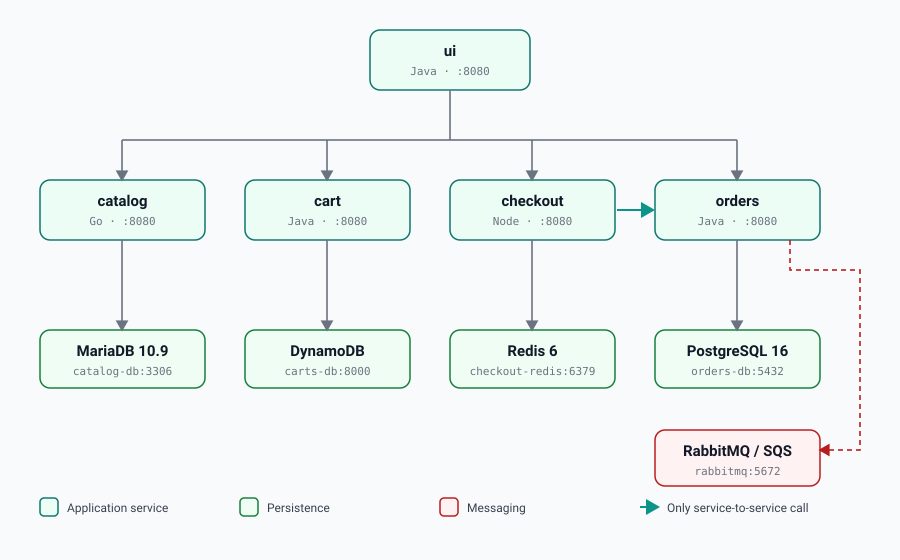

# Loreon Pay #webhook test 

The application you deploy for the DevOps capstone. It is a payments platform: merchants
browse payment products, select the ones they want, and request activation.

Five services, four different datastores and a message queue. Nothing here is difficult
on its own — the difficulty is that it is *distributed*, which is the entire point.



## The services

| Service    | Language | Port | Health                        | Owns                       |
| ---------- | -------- | ---- | ----------------------------- | -------------------------- |
| `ui`       | Java     | 8080 | `/actuator/health/readiness`  | nothing — it is stateless  |
| `catalog`  | Go       | 8080 | `/health`                     | MariaDB / MySQL            |
| `cart`     | Java     | 8080 | `/actuator/health/readiness`  | DynamoDB                   |
| `checkout` | Node     | 8080 | `/health`                     | Redis                      |
| `orders`   | Java     | 8080 | `/actuator/health/readiness`  | PostgreSQL + RabbitMQ      |

Only `ui` is reachable from outside. Everything else is found by hostname on the internal
network, which is why the whole system publishes exactly one port.

`checkout` calls `orders` directly. That is the only service-to-service call in the
system — every other arrow starts at `ui`.

> **The trap that costs people an afternoon:** the `cart` service answers to the DNS name
> **`carts`**, not `cart`. The directory is `cart`, the Kubernetes Service is `carts`.

Also worth knowing before you debug anything:

- **Health paths are not uniform.** The three Java services use `/actuator/health`; Go and
  Node use `/health`. Ports *are* uniform. That asymmetry is what produces a `0/1` pod
  with unhelpful events.
- **Every service defaults its persistence provider to `in-memory`.** A mistyped
  environment variable therefore gives you a *healthy service serving nothing*, rather
  than a crash. This is the single most common false trail.

## Configuration

Every setting is an environment variable named
`LOREONPAY_<SERVICE>_<AREA>_<KEY>`:

```bash
LOREONPAY_UI_ENDPOINTS_CATALOG=http://catalog:8080
LOREONPAY_CATALOG_PERSISTENCE_PROVIDER=mysql
LOREONPAY_ORDERS_MESSAGING_PROVIDER=rabbitmq
```

Find the whole configuration surface with:

```bash
grep -r LOREONPAY_ .
```

For the Java services (`ui`, `cart`, `orders`) that variable name never appears in the
source. Spring's **relaxed binding** derives it from the property tree in
`src/main/resources/application.yml` — uppercase it and turn each `.` into `_`. So
`loreonpay.ui.endpoints.catalog` becomes `LOREONPAY_UI_ENDPOINTS_CATALOG`. Search the
YAML for the property path, not the codebase for the variable.

`catalog` reads its variables via struct tags in `config/config.go`; `checkout` reads
`process.env` directly in `src/config/configuration.ts`.

## Build a service

Each service builds independently — its directory is the Docker build context:

```bash
docker build -t loreon/ui:dev ./src/ui
docker build -t loreon/catalog:dev ./src/catalog
```

There are **no prebuilt images to pull.** You build and push these yourself. That is
deliberate: it is what makes the Docker and CI/CD phases load-bearing rather than
decorative.

The Java services build with Maven inside the image, so the first build is slow and needs
no local JDK. `catalog` needs no local Go toolchain either.

## Run the whole system locally

`src/app/docker-compose.yml` `include:`s each service's own compose file and wires all
five to their datastores. Every service **builds from source**, so you need no registry
and no prebuilt images:

```bash
DB_PASSWORD='anything-local' docker compose -f src/app/docker-compose.yml up --build
```

Then open <http://localhost:8888>. `DB_PASSWORD` is the only variable you must set;
leave it unset and the databases come up with a blank password and the services fail to
connect.

The first run builds five images, three of them Maven, so budget several minutes. Stop
and clean up with:

```bash
docker compose -f src/app/docker-compose.yml down --remove-orphans
```

## Helm

Every service ships its own chart at `src/<service>/chart/`, and `src/app/chart` is the
umbrella that depends on all five. `src/app/helmfile.yaml` deploys the set.

## A note on `catalog`

`catalog/repository/data.go` uses `//go:embed` to compile `products.json` and `tags.json`
**into the binary**, and the final Docker stage copies only the compiled executable. So
editing product data is operationally a *code* change: rebuild, retag, repush, redeploy.
Restarting the container will not pick it up.

Nothing about those JSON files tells you this. The only way to know is to read the build.

## Layout

```
src/
  ui/         Java · Spring WebFlux + Thymeleaf · the merchant dashboard
  catalog/    Go · payment products
  cart/       Java · products pending activation
  checkout/   Node · the go-live request flow
  orders/     Java · activated products, settlement records
  app/        Compose, Helm umbrella chart, Tiltfile
  e2e/        end-to-end tests
  load-generator/
  misc/       shared build config
docs/
```

Each service directory also contains an `ATTRIBUTION.md` listing its third-party
dependency licences. The Dockerfiles copy it into the image, so leave it where it is.
